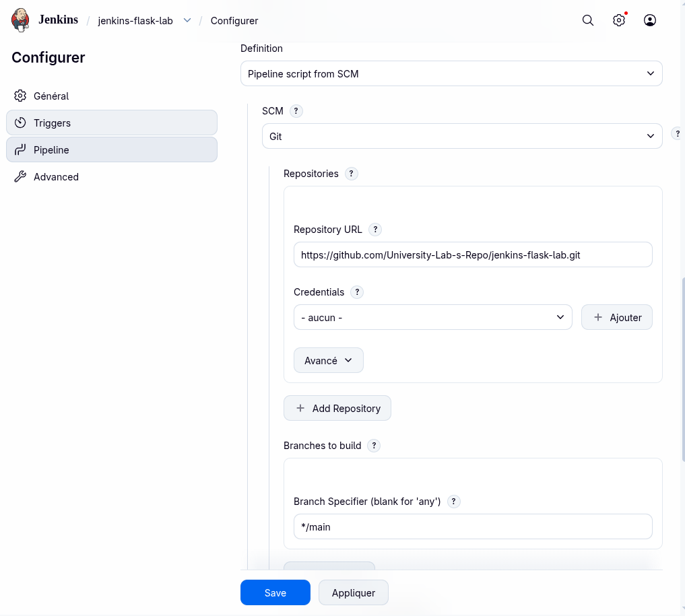
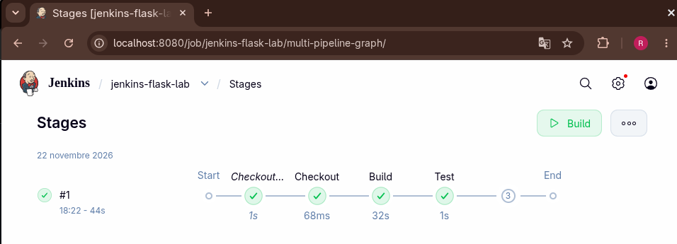
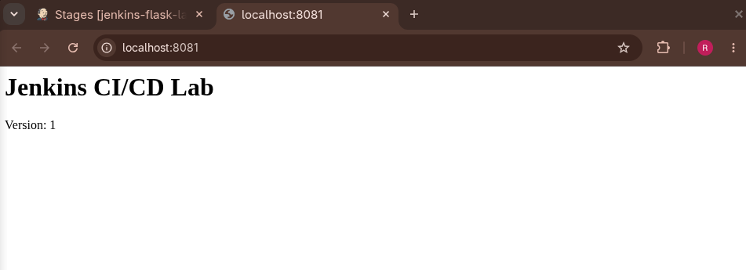
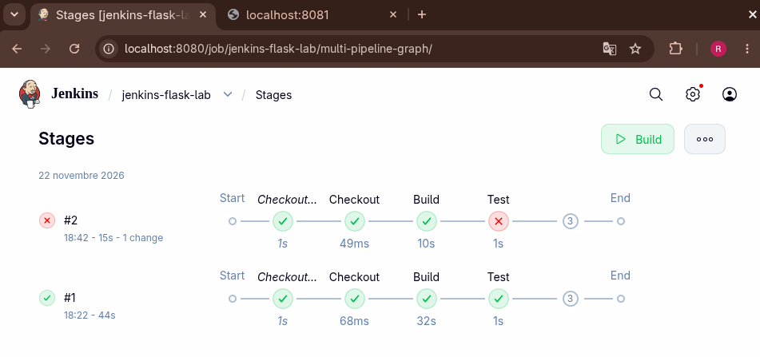
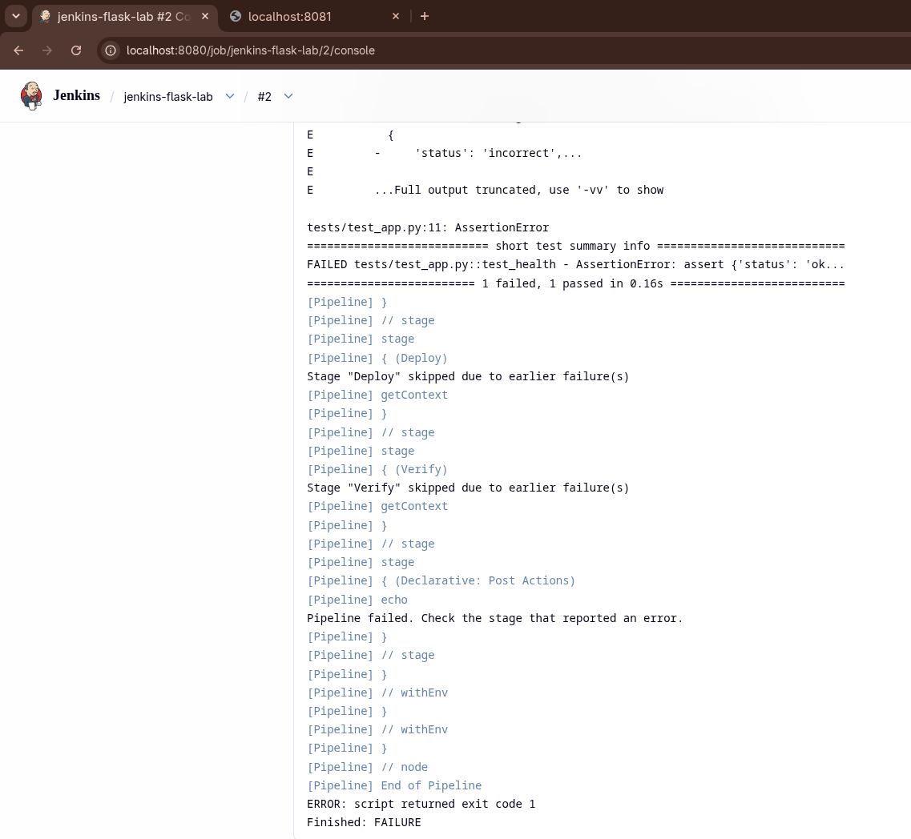
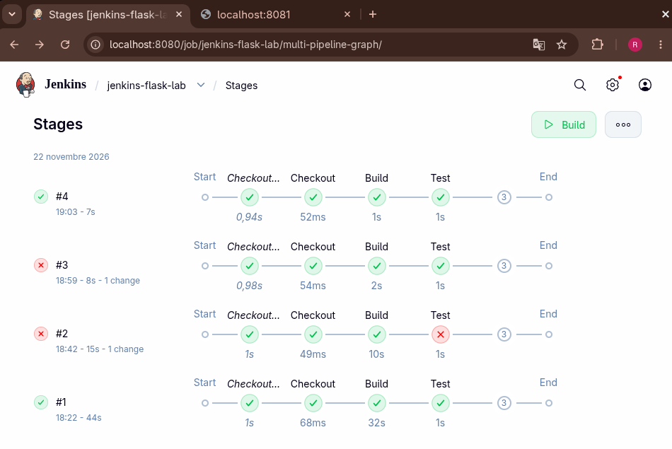
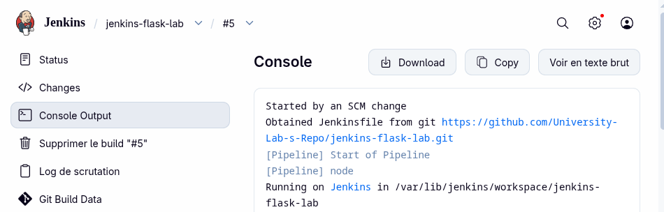

# Jenkins Flask Lab

A small CI/CD project that uses **Jenkins**, **Docker** and **GitHub** to build, test, deploy and verify a Flask web application automatically.

This project was created for **Lab No. 07 – Building a CI/CD Pipeline with Jenkins and Docker** (DevOps & Cloud Computing, 5th-year Software Engineering).

## Overview

```
GitHub → Jenkins Pipeline → Docker Image → Docker Container → Flask Application
```

Each time the pipeline runs, Jenkins gets the code from GitHub, builds a Docker image, runs the automated tests, starts the application in a container and checks that it responds. If a test fails, the pipeline stops and the running application is not replaced.

## Application

The Flask application has two endpoints:

| Endpoint  | Description                                   |
|-----------|-----------------------------------------------|
| `/`       | Home page showing the title and the version   |
| `/health` | Health check, returns `{"status": "ok"}`      |

## Project Structure

```
jenkins-flask-lab/
├── app.py              # Flask application
├── requirements.txt    # Python dependencies (Flask, pytest, gunicorn)
├── Dockerfile          # Docker image definition
├── Jenkinsfile         # Jenkins pipeline definition
├── docs/images/        # Screenshots used in this README
└── tests/
    └── test_app.py     # Automated tests
```

## Pipeline Stages

| Stage        | Purpose                                                          |
|--------------|------------------------------------------------------------------|
| **Checkout** | Gets the source code from GitHub                                 |
| **Build**    | Builds a Docker image tagged with the build number               |
| **Test**     | Runs `pytest` in a temporary container. A failure stops the pipeline |
| **Deploy**   | Removes the old container and starts the new one on port 8081    |
| **Verify**   | Uses `curl` to check `/health` and `/`                           |

## Jenkins Setup


The repository is public, so no credentials are needed. Never store passwords or tokens in the Jenkinsfile. Use the Jenkins credentials store instead.

## Results

### Successful pipeline

All five stages finish successfully and the two automated tests pass.



### Application running

After the Deploy stage, the application runs in a Docker container at <http://localhost:8081> and shows the build number as its version.



## Failure Experiment

To see why tests must run before deployment, the expected value in `tests/test_app.py` was changed to a wrong one and pushed.

The **Test** stage fails. **Deploy** and **Verify** are skipped, so the previous version keeps running.



The console output shows the failed assertion:



After restoring the correct value, the pipeline succeeds again:



## Automatic Trigger

Because Jenkins runs on a private network, GitHub cannot reach it directly. The pipeline is triggered automatically with **Poll SCM** (schedule `H/2 * * * *`), where Jenkins checks GitHub for new commits.

The build below started by itself after a `git push`, without clicking **Build Now**:



## Author

KENNICHE Roumaissa – 5th-year Software Engineering, Computer Science Department
